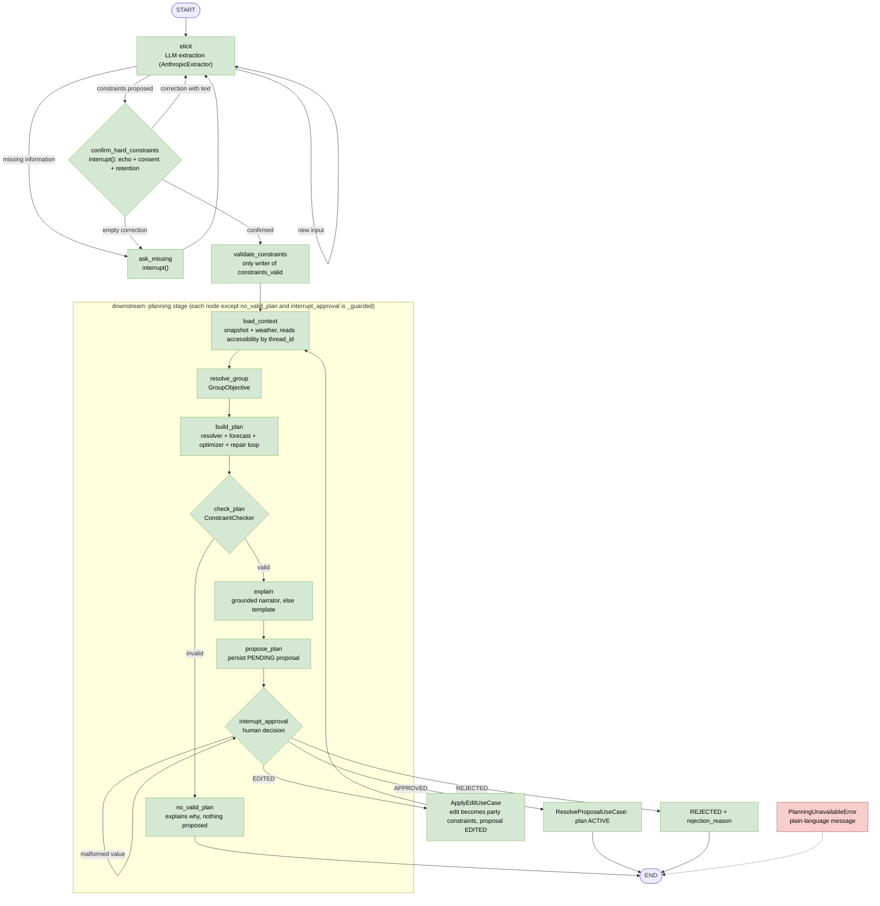
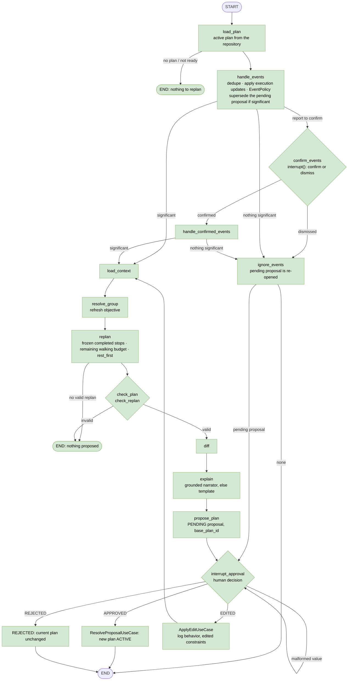

# Agent graph flow (ParkMind)

Static companion to the interactive pages. Open them in a browser:

- [`agent-graph.html`](agent-graph.html): the animated agent graph. replayable scenarios, step-by-step, with a live state panel.
- [`architecture.html`](architecture.html): the animated architecture stack, with flows, boundaries, implementation status and a "Safety & control" overlay showing which components enforce each control.

Green = implemented, dashed yellow = target / stub.

## 1. Initial planning graph

`build_initial_planning_graph()` compiles the elicitation graph and mounts the planning stage as its `downstream` subgraph. Both share `ParkMindState` and the parent's checkpointer.

The LLM only proposes. A hard constraint does not reach the checker until a person confirms it, and accessibility needs consent plus a `retention_policy` (default `session_only`). The plan is activated only by `interrupt_approval` on the resumed, human-driven path.

Notes:

- `propose_plan` is reachable only through the valid edge of `check_plan` and re-asserts `check_result.valid`.
- Nothing before an `interrupt()` has a side effect: LangGraph re-runs a node from the top on resume.
- `EDITED` never activates anything: the edit is applied as party constraints, the proposal is resolved as `EDITED` and planning re-enters at `load_context`. If the edit leaves no valid plan, the previous plan is checked again and re-offered (`before_edit_update`).
- `explain` uses a narrator whose numerals must all appear in the plan or check result (grounding), with the stated and learned preferences labelled; anything ungrounded falls back to the deterministic template. English only for now.
- State holds only `accessibility_ref` (guest ids) [C19].

## 2. Replanning graph

`build_replanning_graph()` runs on the thread of the initial plan with `{"thread_id", "events"}` as input. Constraints, profiles, `accessibility_ref` and the group objective come from that thread's checkpoint; the active plan comes from the repository. A replan is a new `plan_id`, checked by the same `ConstraintChecker` as an initial plan (`check_replan`: the whole day, counting what was already walked). Only the resumed approval interrupt activates it; rejecting keeps the current plan.

Notes:

- `GUEST_FATIGUE` (confirmed) sets the walking cap and makes the new horizon open with a `REST` stop; if it cannot fit, the replan fails closed.
- `EDITED` goes back to `load_context` with the edited constraints: the replan is rebuilt from the active plan and the execution state (a stop already done cannot be removed), checked over the whole day and proposed again. The active plan stays until a proposal is approved.
- Not implemented: REJECT's "update preferences" step; the user-report interpretation front (`INTERPRET`, `SCHEMA VALIDATE`) is upstream of this graph's `events` input.
